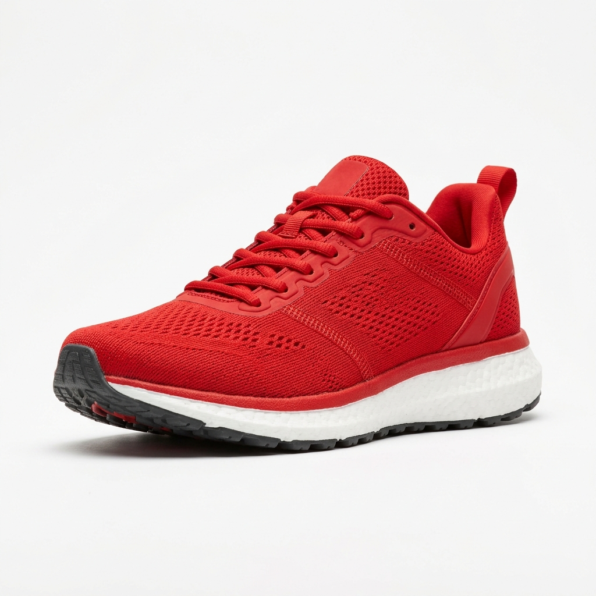
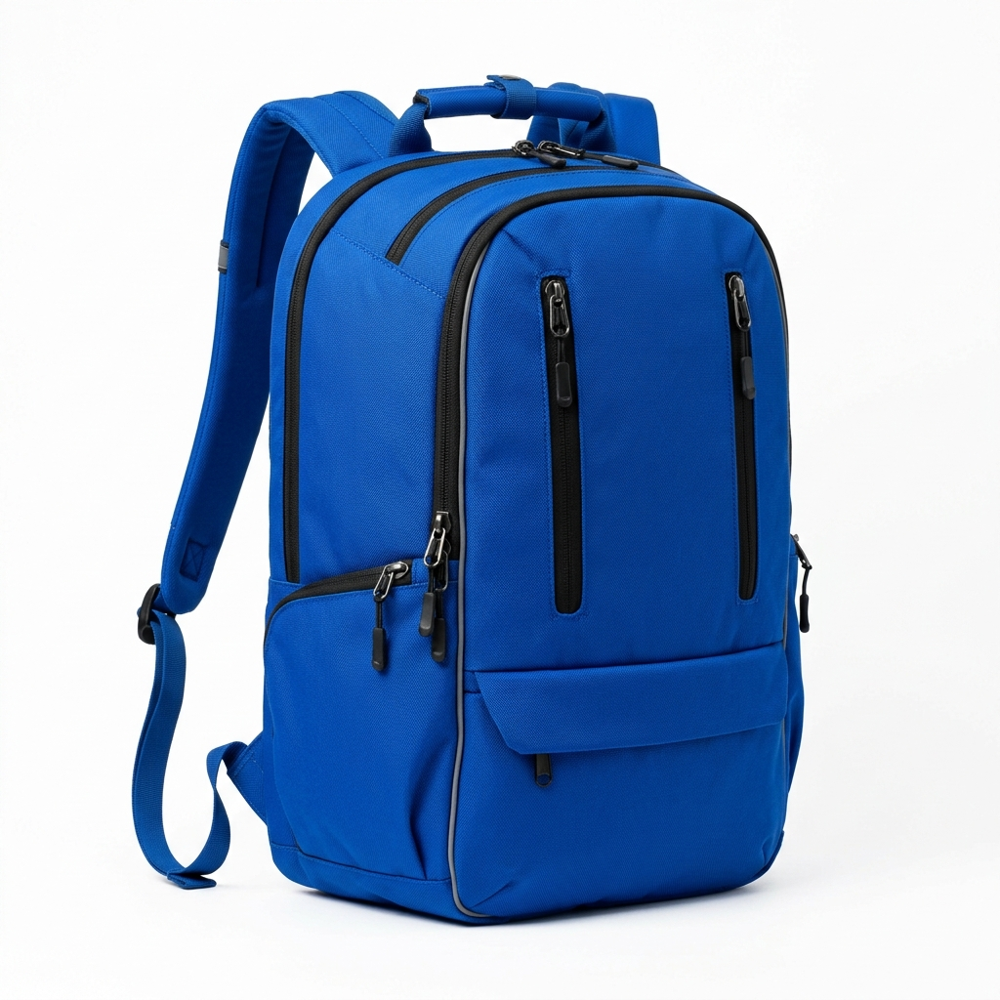
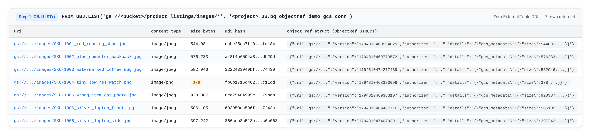
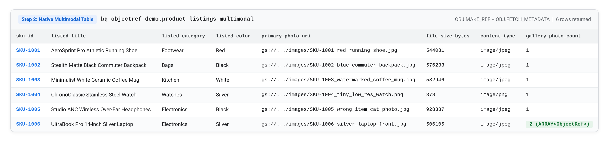
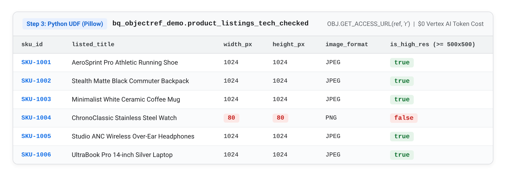
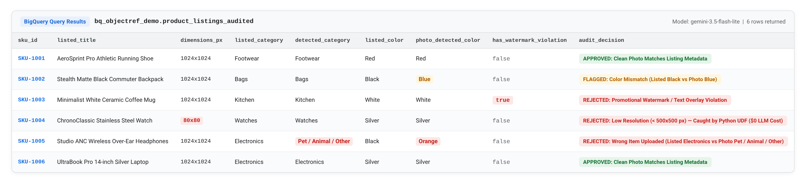

# bigquery-objectref-demo

An end-to-end **Google Cloud BigQuery `ObjectRef`** reference implementation demonstrating how to validate **structured product listing data (`data/product_listings.csv`)** against **unstructured product photos in Cloud Storage (`sample_images/*`)** — without creating legacy External Object Tables.

This repository backs a hands-on engineering review of BigQuery’s newly **Generally Available (GA)** multimodal `ObjectRef` data type, the `OBJ.*` function family (`OBJ.LIST`, `OBJ.MAKE_REF`, `OBJ.FETCH_METADATA`, `OBJ.GET_ACCESS_URL`), **Managed Python UDFs (`Pillow`)**, **Semantic AI SQL (`AI.IF`, `AI.CLASSIFY`, `AI.GENERATE`)**, and **GoogleSQL Pipe Syntax (`|>`)**.

```text
                       ┌──────────────────────────────────────────────────┐
                       │   Cloud Storage Bucket (sample_images/*)         │
                       │   7 Product Listing Photos (.jpg / .png)         │
                       └────────┬────────────────────────────────┬────────┘
                                │                                │
         Step 1: OBJ.LIST()     │                                │ Step 2: OBJ.MAKE_REF()
         (Ad-hoc discovery,     │                                │       + OBJ.FETCH_METADATA()
          zero table DDL)       ▼                                ▼
┌───────────────────────────────────────┐    ┌─────────────────────────────────────────────┐
│ Spontaneous GCS Metadata & ObjectRefs │    │ Native Table: product_listings_multimodal   │
└───────────────────────────────────────┘    │  • sku_id, listed_category, listed_color    │
                                             │  • primary_image_ref  (ObjectRef STRUCT)    │
                                             │  • gallery_image_refs (ARRAY<ObjectRef>)    │
                                             └─────────┬─────────────────────────┬─────────┘
                                                       │                         │
                         Step 3: OBJ.GET_ACCESS_URL()  │                         │ Step 4: Pipe Syntax (|>)
                         + Python UDF (Pillow)         ▼                         ▼ + AI.IF / CLASSIFY / GENERATE
                                    ┌───────────────────────────┐   ┌──────────────────────────────────────┐
                                    │ Resolution Check (UDF)    │   │ Automated Listing Audit Table        │
                                    │ Reads width x height px   │   │  • APPROVED (Red Shoe, Silver Laptop)│
                                    │ Flags 80x80 watch ($0 AI) │   │  • FLAGGED  (Blue Bag listed Black)  │
                                    └───────────────────────────┘   │  • REJECTED (Watermark / Cat Photo!) │
                                                                    └──────────────────────────────────────┘
```

---

## Visual Problem & Solution: Validating `product_listings.csv` Against `sample_images/`

Sellers frequently upload product photos that conflict with their structured listing metadata or violate marketplace rules: wrong color variants, obnoxious promotional watermarks, tiny low-resolution thumbnails, or even completely unrelated pet photos.

By storing `primary_image_ref` (`ObjectRef`) and `gallery_image_refs` (`ARRAY<ObjectRef>`) directly inside our `product_listings_multimodal` table alongside the CSV columns, we can audit every listing in pure SQL:

| SKU & Seller Listing (`data/product_listings.csv`) | Uploaded Photo in GCS (`sample_images/`) | Dimensions | What Our Pipeline Detects |
| :--- | :---: | :---: | :--- |
| **`SKU-1001`**<br>**Title:** AeroSprint Pro Running Shoe<br>**Listed Category:** `Footwear`<br>**Listed Color:** `Red` |  | `1024x1024` | **APPROVED**<br>High-res photo (`>= 500x500`), no watermark (`AI.IF = FALSE`), category (`Footwear`) and color (`Red`) match listing. |
| **`SKU-1002`**<br>**Title:** Stealth Matte Black Backpack<br>**Listed Category:** `Bags`<br>**Listed Color:** **`Black`** |  | `1024x1024` | **FLAGGED: Color Mismatch**<br>Seller listed color as **`Black`**, but `AI.GENERATE` detects the backpack in the photo is **`Blue`**. |
| **`SKU-1003`**<br>**Title:** Minimalist White Ceramic Mug<br>**Listed Category:** `Kitchen`<br>**Listed Color:** `White` |  | `1024x1024` | **REJECTED: Watermark Violation**<br>`AI.IF` detects the giant *"50% OFF MEGA SALE! CALL 1-800-555-MUGS"* promotional banner across the mug. |
| **`SKU-1004`**<br>**Title:** ChronoClassic Stainless Watch<br>**Listed Category:** `Watches`<br>**Listed Color:** `Silver` |  | **`80x80`** | **REJECTED: Low Resolution (`< 500x500`)**<br>Caught in **Step 3** by our **Python UDF (`Pillow` via `OBJ.GET_ACCESS_URL`)** without needing an LLM! |
| **`SKU-1005`**<br>**Title:** Studio ANC Wireless Headphones<br>**Listed Category:** **`Electronics`**<br>**Listed Color:** `Black` |  | `1024x1024` | **REJECTED: Wrong Item Uploaded**<br>Seller listed `Electronics` (Headphones), but `AI.CLASSIFY` identifies the photo as `Pet / Animal / Other` (an orange cat!). |
| **`SKU-1006`**<br>**Title:** UltraBook Pro 14-inch Laptop<br>**Listed Category:** `Electronics`<br>**Listed Color:** `Silver` |   | `1024x1024`<br>*(2 photos in `ARRAY<ObjectRef>`)* | **APPROVED (Multi-Photo Gallery)**<br>Demonstrates storing multiple product angles (`front` + `side ports`) inside an `ARRAY<ObjectRef>` column on a single row. |

---

## Why `ObjectRef` Matters: Legacy Object Tables vs. `ObjectRef` (GA)

Historically, analyzing unstructured GCS files inside BigQuery required creating a separate **External Object Table** (`CREATE EXTERNAL TABLE ... WITH CONNECTION ... OPTIONS(object_metadata='SIMPLE')`). `ObjectRef` replaces that pattern with a native, first-class `STRUCT` data type:

```sql
STRUCT<
  uri STRING,
  version STRING,
  authorizer STRING,
  details JSON
>
```

| Capability | Legacy External Object Tables | New `ObjectRef` Data Type & `OBJ.*` (GA) |
| :--- | :--- | :--- |
| **Where references live** | Isolated in a separate 1-file-per-row external table | Directly inside standard native BigQuery table columns |
| **Multiple files per row** | Requires separate bridge/join tables | Native `ARRAY<ObjectRef>` column on the product row (`SKU-1006`) |
| **Ad-hoc bucket exploration** | Requires running `CREATE EXTERNAL TABLE` DDL first | Instant ad-hoc SQL via `FROM OBJ.LIST('gs://bucket/path/*', 'conn')` |
| **Python UDF file access** | Manual GCS client + SA IAM plumbing | `OBJ.GET_ACCESS_URL(ref, 'r')` generates short-lived signed URLs |
| **Multimodal AI integration** | Verbose `ML.GENERATE_TEXT` subqueries | Pass `(prompt, object_ref)` directly to `AI.IF`, `AI.CLASSIFY`, `AI.GENERATE` |

---

## Repository Layout

```text
bigquery-objectref-demo/
├── .env.example                                  # Configurable project, dataset, bucket, connection IDs
├── Makefile                                      # Shortcuts (make help, make check, make setup, make all)
├── data/
│   └── product_listings.csv                      # Predefined structured marketplace listings (6 rows)
├── sample_images/                                # Predefined product photos uploaded to GCS (7 files)
│   ├── SKU-1001_red_running_shoe.jpg             # 1024x1024 | Valid Red Running Shoe
│   ├── SKU-1002_blue_commuter_backpack.jpg       # 1024x1024 | Color Mismatch: Blue bag listed as 'Black'
│   ├── SKU-1003_watermarked_coffee_mug.jpg       # 1024x1024 | Policy Violation: Giant '50% OFF' spam banner
│   ├── SKU-1004_tiny_low_res_watch.png           # 80x80     | Resolution Violation: Caught by Python UDF
│   ├── SKU-1005_wrong_item_cat_photo.jpg         # 1024x1024 | Wrong Item: Orange tabby cat listed as Headphones
│   ├── SKU-1006_silver_laptop_front.jpg          # 1024x1024 | Gallery Photo #1 in ARRAY<ObjectRef>
│   └── SKU-1006_silver_laptop_side.jpg           # 1024x1024 | Gallery Photo #2 in ARRAY<ObjectRef>
├── scripts/
│   └── run_demo.sh                               # Single end-to-end CLI runner (check, setup, upload, step1..4, teardown)
├── sql/
│   ├── 01_spontaneous_discovery_obj_list.sql     # Step 1: OBJ.LIST() ad-hoc GCS discovery
│   ├── 02_build_multimodal_table_objectref.sql   # Step 2: OBJ.MAKE_REF() + OBJ.FETCH_METADATA() + ARRAY<ObjectRef>
│   ├── 03_python_udf_get_access_url.sql          # Step 3: OBJ.GET_ACCESS_URL() + Python UDF (Pillow)
│   └── 04_multimodal_ai_and_pipe_syntax.sql      # Step 4: AI.IF + AI.CLASSIFY + AI.GENERATE + Pipe Syntax (|>)
└── terraform/
    ├── main.tf                                   # Optional Terraform IaC for bucket, dataset, connection & IAM
    ├── variables.tf
    └── outputs.tf
```

---

## Prerequisites

* `gcloud` CLI and `bq` CLI (pre-installed in Google Cloud Shell)
* A GCP project with permissions to enable BigQuery, Cloud Storage, BigQuery Connection, and Vertex AI APIs

---

## Run in Google Cloud Shell (Recommended)

1. Open [Google Cloud Shell](https://shell.cloud.google.com).
2. Clone the repository:

```bash
git clone https://github.com/simonleewm/bigquery-objectref-demo.git
cd bigquery-objectref-demo

# 1. Copy .env.example to .env and fill in GCP_PROJECT_ID, GCLOUD_ACCOUNT, and GCS_BUCKET_NAME
cp .env.example .env
make check                        # Verifies .env, gcloud auth, product_listings.csv & sample_images/*

# 2. (Optional) Preview all gcloud/bq commands and rendered SQL offline first
make dry-run

# 3. One-time GCP provisioning (APIs, GCS bucket, BQ dataset, Cloud Resource Connection & IAM)
make setup

# 4. Upload sample_images/* + product_listings.csv and execute all 4 SQL steps
make all
```

Or run the SQL steps individually to inspect each stage:

```bash
make upload           # Upload sample_images/* to GCS and load product_listings.csv into BQ staging
make step1            # Step 1: Query GCS images on the fly using OBJ.LIST()
make step2            # Step 2: Build native multimodal table with ObjectRef & ARRAY<ObjectRef>
make step3            # Step 3: Check image pixel resolution via OBJ.GET_ACCESS_URL() + Python UDF (Pillow)
make step4            # Step 4: Audit listings using AI.IF, AI.CLASSIFY, AI.GENERATE, and Pipe syntax (|>)
```

### Clean Up

```bash
make teardown         # Deletes the demo BQ dataset, connection, and uploaded GCS images
```

---

## Sample Query Outputs

### Step 1 (`make step1`): Ad-Hoc GCS Discovery via `OBJ.LIST()`
Scans `gs://<your-bucket>/product_listings/images/*` directly without creating an External Object Table, returning a pre-populated `ObjectRef` (`object_ref_struct`) per file:



### Step 2 (`make step2`): Native Multimodal Table (`ObjectRef` & `ARRAY<ObjectRef>`)
Combines structured CSV columns with `primary_image_ref` and a multi-photo `gallery_image_refs` (`ARRAY<ObjectRef>`) column on `SKU-1006`:



### Step 3 (`make step3`): Pixel Resolution Gate via `OBJ.GET_ACCESS_URL()` + Python UDF (`Pillow`)
Streams each image via a short-lived signed URL inside a Managed Python UDF to inspect pixel dimensions at `$0` Vertex AI token cost:



### Step 4 (`make step4`): Final Multimodal Audit (`AI.IF` + `AI.CLASSIFY` + `AI.GENERATE` + Pipe `|>`)
Evaluates every listing using `gemini-3.5-flash-lite` and produces the final audit decision:


