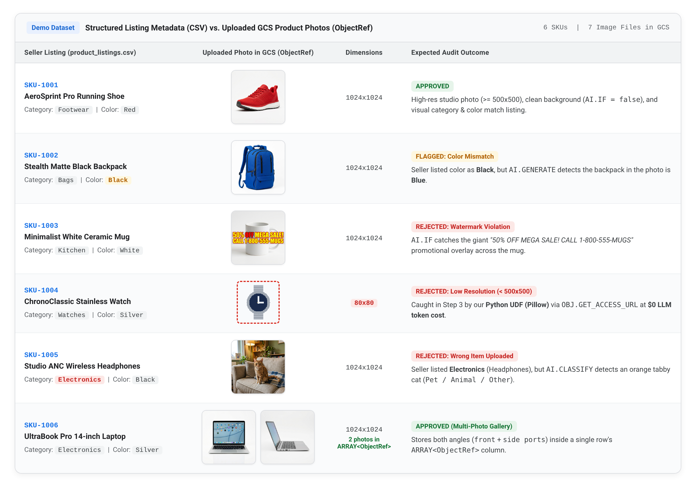
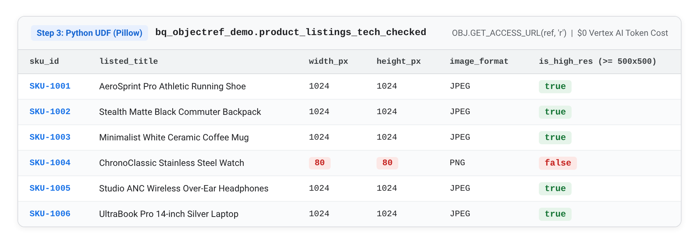
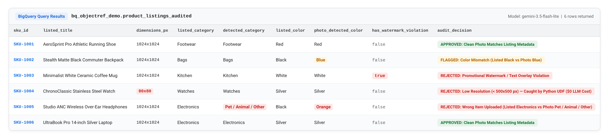

# Images Inside Your SQL Warehouse: First Look at BigQuery `ObjectRef`

*No data duplication, no external table sprawl—just governed Cloud Storage pointers inside regular BigQuery tables, audited with Python and Gemini in pure SQL.*

---

If you work with Google Cloud BigQuery, you already know the classic divide: **structured data** (SKUs, prices, categories) lives in BigQuery tables, while **unstructured files** (product photos, receipts, PDFs) live in Cloud Storage (GCS) buckets.

Until recently, analyzing those GCS files inside BigQuery meant creating a separate **External Object Table**—where every file in a bucket became its own isolated row—and writing brittle string-matching `JOIN`s back to your business tables. Want to attach three gallery photos to a single product row? You couldn't do that natively.

With **BigQuery `ObjectRef`** (and **`OBJ.LIST`**) now Generally Available (GA), Google Cloud gives us a cleaner option. External Object Tables still make sense when you want a cached directory index over millions of raw files in a bucket—but when files belong to structured business rows like products, orders, or claims, `ObjectRef` lets you store **governed GCS file pointers as a native column type** right inside standard BigQuery tables.

Instead of keeping things theoretical, I built and ran a small end-to-end demo to see how `ObjectRef` behaves in practice. You can clone the full working project here: **[github.com/simonleewm/bigquery-objectref-demo](https://github.com/simonleewm/bigquery-objectref-demo)**.

---

## What Exactly Is `ObjectRef`?

Under the hood, an `ObjectRef` is a predefined BigQuery `STRUCT`:

```sql
STRUCT<
  uri STRING,        -- e.g. gs://my-bucket/images/shoe.jpg
  version STRING,    -- GCS object generation ID
  authorizer STRING, -- BigQuery Cloud Resource Connection ID
  details JSON       -- Cached GCS metadata (size, content_type, md5)
>
```

Because it is just a data type:
1. **Zero data movement:** Your heavy image or PDF bytes stay in Cloud Storage, while BigQuery stores lightweight, permission-governed pointers right next to your standard `STRING` and `NUMERIC` columns.
2. **Multi-file rows work naturally:** You can define an `ARRAY<ObjectRef>` column to store an entire photo gallery on a single row.
3. **Plug-and-play with Python & Gemini:** Both BigQuery Python UDFs and BigQuery’s managed AI functions (`AI.IF`, `AI.CLASSIFY`, `AI.GENERATE`) natively understand `ObjectRef` columns.

---

## The Demo Scenario: Auditing E-Commerce Product Photos

Imagine sellers uploading structured product listings (`product_listings.csv`) alongside product photos in GCS (`sample_images/`). Sellers make mistakes—and sometimes try to game marketplace rules.

To test `ObjectRef` visually, I set up **6 product listings** paired with **7 sample images** covering clean matches, color mismatches, spam watermarks, tiny low-res thumbnails, and an accidental cat photo:



> 📸 **[GCP Console Screenshot Placeholder #1 — Cloud Storage Bucket Browser]**
> * **Where to capture:** `GCP Console -> Cloud Storage -> Buckets -> <your-bucket>/product_listings/images/`
> * **What to show:** The 7 uploaded image files with their Type (`image/jpeg`, `image/png`) and Size column visible—readers will immediately spot `SKU-1004_tiny_low_res_watch.png` sitting at `378 B` next to the ~500 KB studio photos.

---

## How the 4-Step SQL Pipeline Works

### Step 1: Explore GCS Instantly with `OBJ.LIST`
Previously, peeking at files in GCS from BigQuery required `CREATE EXTERNAL TABLE` DDL first. Now, `OBJ.LIST()` acts as an ad-hoc table function that returns file attributes plus a ready-to-use `ref` (`ObjectRef`) column:

```sql
SELECT uri, content_type, size AS size_bytes, ref
FROM OBJ.LIST(
  'gs://my-demo-bucket/product_listings/images/*',
  'my-project.US.bq_objectref_demo_gcs_conn'
);
```

---

### Step 2: Store `ObjectRef` Inside a Standard Table
Next, we join our CSV staging table with GCS pointers using `OBJ.MAKE_REF()` and populate file metadata (`size`, `content_type`, `md5_hash`) using `OBJ.FETCH_METADATA()`:

```sql
SELECT
  sku_id,
  listed_category,
  listed_color,
  -- Single primary image pointer
  OBJ.FETCH_METADATA(
    OBJ.MAKE_REF(CONCAT('gs://my-bucket/images/', primary_image), 'my-project.US.conn')
  ) AS primary_image_ref,
  -- Multiple gallery photos on the same row (ARRAY<ObjectRef>)!
  OBJ.FETCH_METADATA(
    ARRAY(
      SELECT OBJ.MAKE_REF(CONCAT('gs://my-bucket/images/', img), 'my-project.US.conn')
      FROM UNNEST(SPLIT(gallery_images, '|')) AS img
    )
  ) AS gallery_image_refs
FROM `my_project.bq_objectref_demo.product_listings_staging`;
```

> 📸 **[GCP Console Screenshot Placeholder #2 — BigQuery Table Schema Tree]**
> * **Where to capture:** `BigQuery Studio -> Explorer -> bq_objectref_demo -> product_listings_multimodal -> Schema tab`
> * **What to show:** Expand both `primary_image_ref` (`RECORD`) and `gallery_image_refs` (`RECORD / REPEATED`) so beginners can visually see `uri`, `version`, `authorizer`, and `details (JSON)` living as nested fields right alongside `sku_id`, `listed_category`, and `listed_color`!

---

### Step 3: Check Pixel Dimensions for $0 AI Cost (`OBJ.GET_ACCESS_URL`)
You don't need an LLM just to check if an image is `80x80` pixels. Calling `OBJ.GET_ACCESS_URL(primary_image_ref, 'r')` generates a short-lived signed GCS URL that we pass into a BigQuery Managed Python UDF running `Pillow` (see `sql/03_python_udf_get_access_url.sql` in the repo for the UDF definition):

```sql
SELECT
  sku_id,
  `my_project.bq_objectref_demo.inspect_image_dimensions`(
    TO_JSON_STRING(OBJ.GET_ACCESS_URL(primary_image_ref, 'r'))
  ) AS image_tech_check
FROM `my_project.bq_objectref_demo.product_listings_multimodal`;
```

It inspects all 6 images and flags `SKU-1004` (`80x80`, `is_high_res = false`) without spending a single Gemini token:



---

### Step 4: Multimodal Audit with `AI.IF`, `AI.CLASSIFY`, `AI.GENERATE` & Pipe Syntax (`|>`)
Finally, using BigQuery’s sequential **Pipe Syntax (`|>`)** and the low-cost `gemini-3.5-flash-lite` model, we pass `primary_image_ref` directly into three semantic SQL functions:

```sql
FROM `my_project.bq_objectref_demo.product_listings_tech_checked`
|> EXTEND
     AI.IF(
       ('Does this product photo contain promotional text overlays or sale watermarks?', primary_image_ref),
       connection_id => 'my-project.US.conn', endpoint => 'gemini-3.5-flash-lite'
     ) AS has_watermark_violation,
     AI.CLASSIFY(
       primary_image_ref,
       categories => ['Footwear', 'Bags', 'Kitchen', 'Watches', 'Electronics', 'Pet / Animal / Other'],
       connection_id => 'my-project.US.conn', endpoint => 'gemini-3.5-flash-lite'
     ) AS detected_category,
     AI.GENERATE(
       ('Identify the primary color of the main subject in one word.', primary_image_ref),
       output_schema => 'detected_color STRING',
       connection_id => 'my-project.US.conn', endpoint => 'gemini-3.5-flash-lite'
     ) AS visual_attributes
|> SELECT sku_id, listed_category, detected_category, listed_color,
          visual_attributes.detected_color AS photo_detected_color, has_watermark_violation;
```

Here is the actual output from running `make step4` in Cloud Shell—catching every single defect across all 6 SKUs:



---

## 3 Gotchas I Learned Running It Myself

1. **`OBJ.LIST` takes positional arguments:** Pass the connection ID as the second positional parameter (`OBJ.LIST('gs://...', 'project.location.conn')`) rather than a named argument.
2. **Python UDFs are network-isolated by default:** When reading signed URLs from `OBJ.GET_ACCESS_URL`, include `WITH CONNECTION` and `entry_point` on your `CREATE FUNCTION` statement so the Python container is allowed to reach GCS.
3. **`gemini-3.5-flash-lite` is plenty fast and cheap:** For straightforward multimodal checks like watermarks, categories, and colors, `gemini-3.5-flash-lite` nailed 6 out of 6 listings for a fraction of a cent.

---

## Try the Demo Yourself

All sample images, the CSV dataset, automated `Makefile` / Cloud Shell runner scripts, Terraform configs, and full SQL queries are available in my GitHub repository:

👉 **[https://github.com/simonleewm/bigquery-objectref-demo](https://github.com/simonleewm/bigquery-objectref-demo)**

Check out the repository’s **`README.md`** for step-by-step Cloud Shell setup instructions, IAM roles, and `make teardown` cleanup commands so you can spin the whole pipeline up and down in under five minutes.
